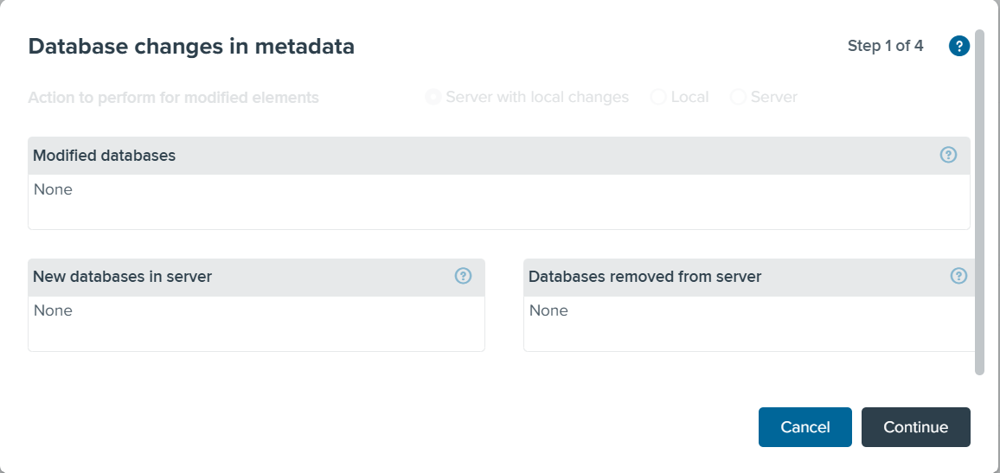
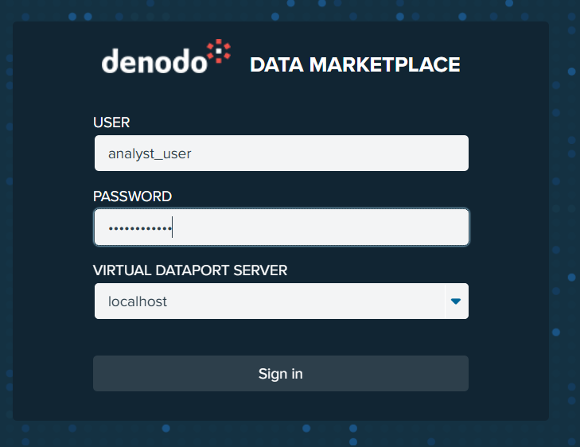
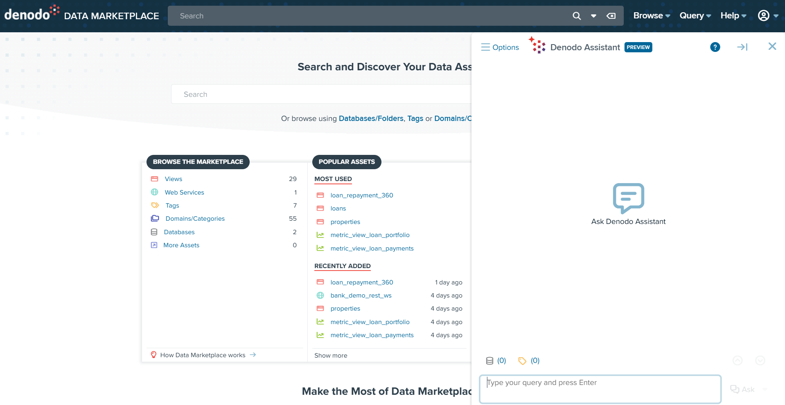
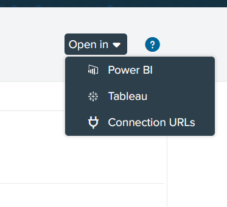
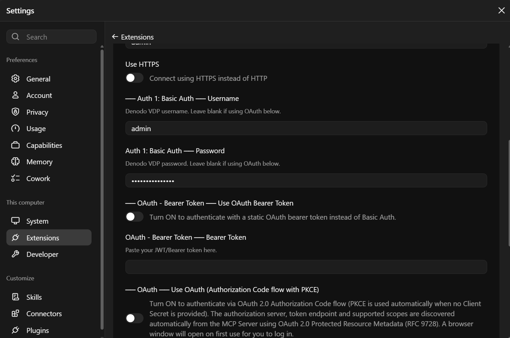

# Business Analyst

## Introduction

Use the Denodo Data Marketplace to find, review and request access to data products. Get analytical insights in plain English with the Denodo Assistant.

In this tour you will:

* Discover a data product
* Review its metadata
* Ask an analytical question with the Denodo Assistant
* Export the results to CSV
* Request access to a restricted view

**Data Marketplace URL:** `https://try-dev.dimv.foo/denodo-data-catalog/`

---

## 1. Before You Start (Administrator)

Data products created in Design Studio must be synchronized with the Data Marketplace manually.

1. Sign in to the Data Marketplace as an administrator.
2. Go to **Administration > Synchronize with Virtual DataPort**.
3. Review the new and changed elements.
4. Click **Synchronize**.

---

## 2. Sign In

1. Open `https://try-dev.dimv.foo/denodo-data-catalog/`.
2. Select the Virtual DataPort server.
3. Enter the analyst credentials:
    - **User:** `<analyst_user>`
    - **Password:** `<analyst_password>`
4. Click **Sign in**.

---

## 3. Discover a Data Product

1. On the home page, type `<keyword>` in the search bar.
2. Press **Enter**.
3. Click the data product `<data_product_name>`.

---

## 4. Review Metadata

1. Open the **Summary** tab and read the description, owner, tags and categories.
2. Open the **Schema** tab and review the fields and their descriptions.
3. Open the **Lineage** tab to see where the data comes from.

---

## 5. Ask an Analytical Question (Data Marketplace)

1. Click the **Denodo Assistant** button in the bottom corner of the screen.
2. Select **Ask** mode.
3. Type your question, for example:
    - *What are the top 10 customers by total transaction amount?*
    - *Show the monthly loan totals for 2025 by branch.*
4. Press **Enter**.
5. Review the answer, the generated query and the results.

## 6. Ask an Analytical Question (AI SDK)

1. Click the **Denodo Assistant** button in the bottom corner of the screen.
2. Select **Ask** mode.
3. Type your question, for example:
    - *What are the top 10 customers by total transaction amount?*
    - *Show the monthly loan totals for 2025 by branch.*
4. Press **Enter**.
5. Review the answer, the generated query and the results.

---

## 7. Export Results to CSV

1. In the query results, click **Export**.
2. Select **CSV**.
3. Click **Download**.

---

## 8. Request Access to a Restricted View

1. Search for `<restricted_view_name>`.
2. Open the view. A message shows that you don't have access.
3. Click **Request access**.
4. Enter a reason for the request.
5. Click **Send**.

---

## 9. Open in Power BI

1. Open the data product `<data_product_name>`.
2. In the Open In Drop-Down, Click **Power BI** / **Tableau** depending on your BI tool.
3. Open the downloaded file in Power BI Desktop.
4. Sign in with your Denodo credentials.

---

## 10. Ask Claude (Or Other AI Agent Harness)

1. Connect Claude Desktop to Denodo. See **Deliver Active Context for AI > Connect Claude Desktop to Denodo**.
2. Ask Claude:
    - *Find the data products about customers.*
    - *What are the top 10 customers by total transaction amount?*

