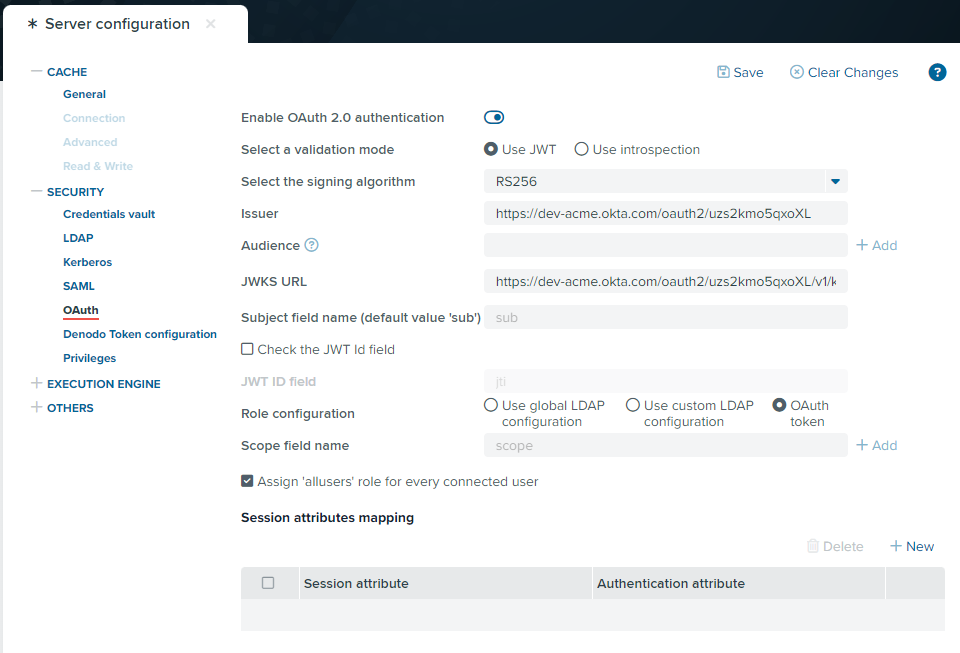
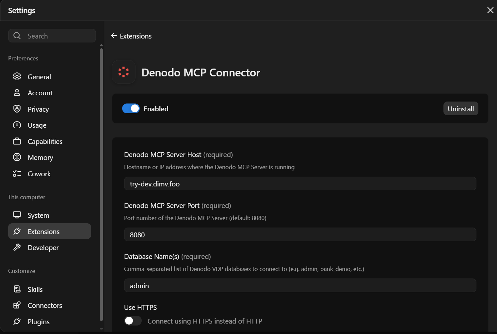
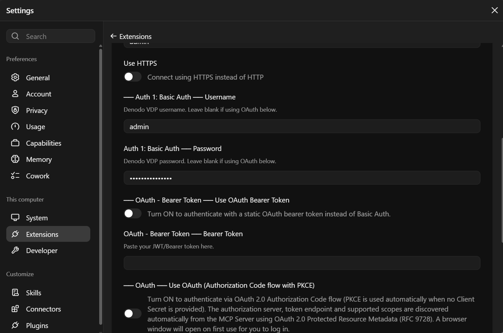
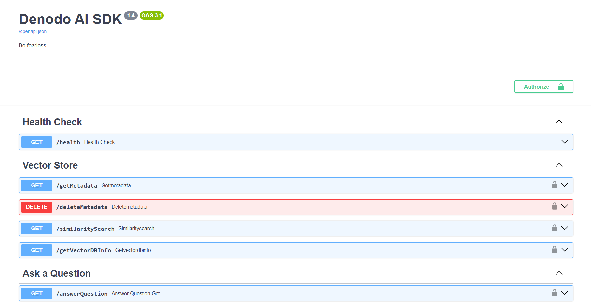
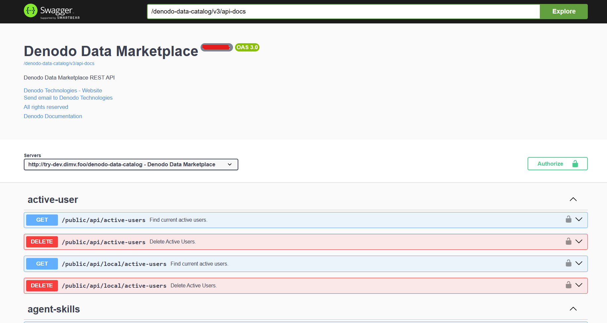

# Deliver Active Context for AI

## Introduction

Denodo Platform delivers governed, real-time context to AI agents through the following services:

* MCP Services
    - VDP MCP - Schema introspection and VQL execution
    - AI-SDK MCP - Natural language query
* REST-APIs
    - AI-SDK - Stateless Text to VQL REST service
    - Data Marketplace
    - GraphQL
    - VDP RESTful

---

## 1. MCP Services

### 1.1 VDP MCP

**The Denodo MCP Server provides:**

- Read-only access to Denodo databases
- MCP resources describing the metadata of the database and of each view
- MCP tools to search metadata, list views, get view schemas, and execute and validate VQL queries
- Tag-based metadata visibility across multiple databases

**MCP Endpoint:** `https://try-dev.dimv.foo/mcp/admin/mcp`

### 1.2 AI-SDK MCP

Connect the AI-SDK as an MCP server to any MCP-compatible client (Visual Studio Code, Claude Desktop, Cursor…) via remote MCP (HTTP).

**AI-SDK MCP Endpoint:** `https://try-dev.dimv.foo/aisdk/mcp`

### 1.3 Authentication

#### 1.3.1 Basic Authentication

1. Open your MCP client configuration (VS Code, Cursor, etc.).
2. Add this server:

```json
{
  "servers": {
    "Denodo": {
      "url": "https://try-dev.dimv.foo/mcp/admin/mcp",
      "type": "http",
      "headers": {
        "Authorization": "Basic YWRtaW46YWRtaW4="
      }
    }
  }
}
```

3. Save and start the server.


#### 1.3.2 OAuth

**Step 1: Register an app in your Identity Provider**

**Step 2: Enable OAuth in VDP**

1. Go to **Administration > Server configuration > Security > OAuth**.


2. Set these values:

| Field | Value |
|-------|-------|
| Enable OAuth 2.0 authentication | Enabled |
| Validation mode | Use JWT |
| Signing algorithm | `<RS256>` |
| Issuer | `<issuer>` |
| JWKS URL | `<jwks_url>` |
| Attribute with the user's roles | `scp` |

3. Click **Save**.




### 1.4 Connect Claude Desktop to Denodo

1. Open [Denodo MCP Connector](https://claude.com/connectors/denodo-mcp-connector).
2. Click **Add to Claude**.


3. Click **Install**.
4. Enter the Hostname `try-dev.dimv.foo`.


5. Select the authentication mode and enter your credentials. Use either the Basic or Oauth.


6. Save the Config.


### 1.5 Try It

Ask Claude:

- *List the views in my Denodo database.*
- *Describe the schema of the customer view.*
- *Show the top 10 customers by number of orders.*


---

## 2. REST APIs

### 2.1 AI-SDK REST API

#### Key features

- **Text-to-VQL:** Translates natural language questions into VQL, so AI agents can query Denodo without writing SQL/VQL.
- **Metadata Search (RAG):** Indexes technical and business metadata for semantic search.
- **DeepQuery Agent:** Builds and runs a multi-step plan combining metadata discovery with live VQL queries.
- **Model & Vector Store Agnostic:** Switch between LLMs and vector databases as needed.

#### AI-SDK API Swagger documentation

`https://try-dev.dimv.foo/aisdk/docs`



### 2.2 Data Marketplace

The Data Marketplace REST API performs programmatically all the tasks available in the GUI.

#### DM API Swagger documentation

`https://try-dev.dimv.foo/denodo-data-catalog/swagger-ui/index.html`



### 2.3 GraphQL

Run GraphQL queries against the Denodo virtual data model.

**GraphQL Endpoint:** `https://try-dev.dimv.foo/denodo-graphql-service/graphql/<database>/schema.json`

**Examples:**

- `https://try-dev.dimv.foo/denodo-graphql-service/graphql/bank_demo/schema.json`
- `https://try-dev.dimv.foo/denodo-graphql-service/graphql/medixit/schema.json`

### 2.4 VDP RESTful

The RESTful web service publishes the contents of the entire Virtual DataPort server over HTTP.

**RESTful web service Endpoint:** `https://try-dev.dimv.foo/denodo-restfulws/<database>`

**Examples:**

- `https://try-dev.dimv.foo/denodo-restfulws/admin` returns the list of views of the database `admin`.
- `https://try-dev.dimv.foo/denodo-restfulws/admin/views/customer` returns the content of the view `customer`.
- `https://try-dev.dimv.foo/denodo-restfulws/admin/views/customer/1/orders` browses the `orders` mapping of the `customer` row with primary key 1.
- `https://try-dev.dimv.foo/denodo-restfulws/OpenAPIv3/openapi.json` returns the OpenAPI 3 document in JSON.
- `https://try-dev.dimv.foo/denodo-restfulws/OpenAPIv3/openapi.yaml?database=db1&database=db2&tag=tag1&tag=tag2` returns the OpenAPI 3 document in YAML for views in databases `db1` or `db2` with tags `tag1` or `tag2`.