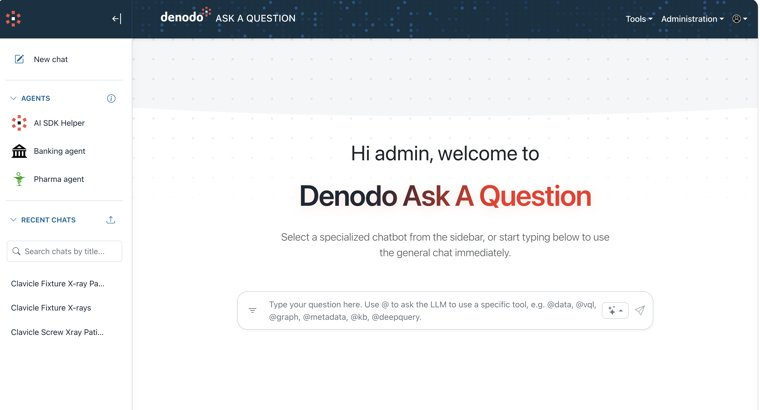
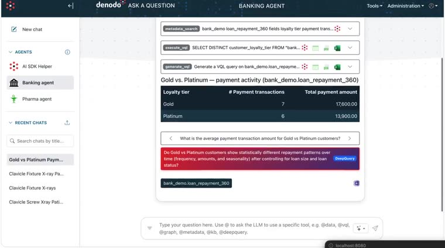
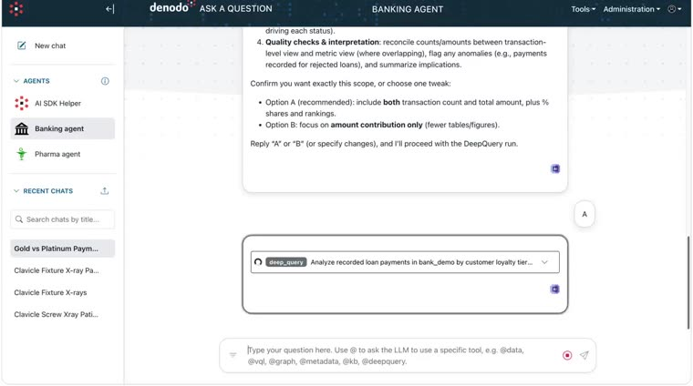

# AI Builder tour

About 3 min · 6 steps · Live Denodo Platform

Build AI agents and applications with the Denodo AI SDK, or connect your existing AI agents to governed enterprise data through the Denodo MCP Server.

## Why this tour

Crestbank wants staff and applications to ask repayment questions in plain English and get correct, governed answers. You see an AI SDK agent answer from the loan repayment data product, then ask the same question from your own code and from your own agent.

**Sign in as:** `ai_builder`

## Steps

### 1. Open the AI SDK chatbot

Ask a Question is the Denodo AI SDK sample chatbot.

1. Select **Open Ask a Question** and sign in as **ai_builder**.
2. In the sidebar, under **AGENTS**, choose **Banking agent**. It works on bank_demo, with DeepQuery and reports turned on.



**Why this matters:** This is a finished agent built on the AI SDK. The next steps show what it does underneath, so you can build your own.

**You should see:** The chatbot is open and the Banking agent is selected.

### 2. Ask the Crestbank question

1. Paste the question below and send it.
2. Watch the steps the agent runs: **metadata_search** finds the views, **execute_sql** and **generate_vql** run the query on Denodo.
3. Open a step to see the views it found and the VQL it ran.

```
Compare Gold and Platinum customer loyalty tiers in bank_demo.loan_repayment_360. Return the number of recorded payment transactions and the total payment amounts for each tier.
```



[Watch this step](../../assets/videos/guide/ai-2-clip.mp4): The Banking agent runs its steps, then answers with a table for Gold and Platinum.

**Why this matters:** The answer is traceable. You see the views and the VQL behind it, not only the text.

**You should see:** Gold: 7 payments, 17,600. Platinum: 6 payments, 13,900.

### 3. Hand a bigger question to DeepQuery (optional)

DeepQuery is the AI SDK research agent. It plans the analysis, runs several queries and writes a report.

1. Ask the question below.
2. DeepQuery proposes an analysis plan with two options. Reply **A** to accept the recommended option.
3. Wait while it runs the queries. A long analysis can take a few minutes.

```
Analyse recorded loan payments in bank_demo by customer loyalty tier and loan status. Which tiers contribute most, and how do approved, pending and rejected loans differ?
```



[Watch this step](../../assets/videos/guide/ai-3-clip.mp4): DeepQuery proposes an analysis plan, then starts the analysis.

**You should see:** A plan, the queries it ran and a written report.

### 4. Sign in from your terminal

Command-line calls to this trial need a Cloudflare Access sign-in.

1. Choose your system below.
2. Run the commands. Your browser opens to confirm the sign-in.

Mac (Terminal):

```
brew install cloudflared
cloudflared access login https://try-dev.dimv.foo
```

Windows (PowerShell):

```
winget install --id Cloudflare.cloudflared
# Close and reopen PowerShell, then run:
cloudflared access login https://try-dev.dimv.foo
```

**You should see:** The terminal shows Successfully fetched your token, and your browser shows that the sign-in succeeded.

### 5. Ask the same question from code

1. Download **question.json**.
2. In your terminal, go to the folder you saved it in: type **cd ~/Downloads** on a Mac or **cd $HOME\Downloads** on Windows, and press Enter.
3. Paste the command below as one line and press Enter.
4. When the terminal asks for the host password, enter the password for **ai_builder**.

Mac (Terminal):

```
cloudflared access curl https://try-dev.dimv.foo/aisdk/answerDataQuestion -u ai_builder -X POST -H "Content-Type: application/json" --data-binary @question.json
```

Windows (PowerShell):

```
cloudflared access curl https://try-dev.dimv.foo/aisdk/answerDataQuestion -u ai_builder -X POST -H "Content-Type: application/json" --data-binary "@question.json"
```

Download: [question.json](../../pages/guide-files/question.json)

> If you see Authentication failed: Invalid credentials for Data Marketplace, check that the user name is spelled exactly ai_builder and that the password is correct.

**Why this matters:** The same question and the same governed answer, from your own code. This is the endpoint your application calls.

**You should see:** A JSON answer with the VQL it generated and the same totals: Gold 7 and 17,600, Platinum 6 and 13,900.

### 6. Connect your own agent over MCP (optional)

1. Open **MCP and API** and copy the **AI-SDK MCP Endpoint**: https://try-dev.dimv.foo/aisdk/mcp
2. Add it to an MCP-capable client, such as Visual Studio Code, with the configuration shown on that page.
3. Ask your agent the Crestbank question.

**You should see:** Your client lists the Denodo tools and answers from bank_demo.

## What happens next in the story

The same governed data product now answers through an agent, from code and over MCP. Every answer uses the definitions the Data Engineer published and the permissions of the user who asks.
