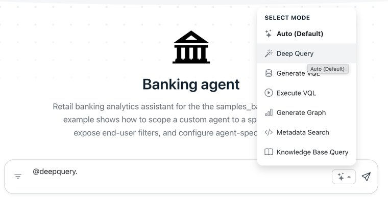

# AI Builder tour

About 5 min · 5 steps · Live Denodo Platform

Build AI agents and applications with the Denodo AI SDK, or connect your existing AI agents to governed enterprise data through the Denodo MCP Server.

## Why this tour

Crestbank wants staff and applications to ask repayment questions in plain English and get correct, governed answers. You see an AI SDK agent answer from the loan repayment data product, then ask the same question from your own code, and optionally from your own agent over MCP.

**Sign in as:** `ai_builder`

## Steps

### 1. Open the AI SDK chatbot

Ask a Question is the Denodo AI SDK sample chatbot.

1. Select **Open Ask a Question** and sign in as **ai_builder**.
2. In the sidebar, under **AGENTS**, choose **Banking agent**, a sample AI SDK agent for banking questions.


**Why this matters:** This is a finished agent built on the AI SDK. The next steps show what it does underneath, so you can build your own.

**You should see:** The chatbot is open and the Banking agent is selected.

### 2. Ask the Crestbank question

1. Paste the question below and send it.
2. Watch the steps the agent runs: **metadata_search** finds the views, **execute_vql** checks the tier values, and **generate_vql** writes and runs the query on Denodo.
3. Open a step to see the views it found and the VQL it ran.

```
Compare Gold and Platinum customer loyalty tiers in bank_demo.loan_repayment_360. Return the number of recorded payment transactions and the total payment amounts for each tier.
```


[Watch this step](../../assets/videos/guide/ai-2-clip.mp4): The Banking agent runs its steps, then answers with a table for Gold and Platinum.

**Why this matters:** The answer is traceable. You see the views and the VQL behind it, not only the text.

**You should see:** Gold: 7 payments, 17,600. Platinum: 6 payments, 13,900.

### 3. Hand a bigger question to DeepQuery (optional)

DeepQuery is the AI SDK research agent. It plans the analysis, runs several queries and writes a report.

1. Switch the chatbot to DeepQuery: select the **✦** button to the left of the send arrow, then under **SELECT MODE** choose **Deep Query**. You can also type **@deepquery** at the start of your question.
2. Paste the question below and send it.
3. DeepQuery proposes an analysis plan with two options. Reply **A** to accept the recommended option.
4. Wait while it runs the queries. A long analysis can take a few minutes.

```
Analyse recorded loan payments in bank_demo by customer loyalty tier and loan status. Which tiers contribute most, and how do approved, pending and rejected loans differ?
```




[Watch this step](../../assets/videos/guide/ai-3-clip.mp4): DeepQuery proposes an analysis plan, then starts the analysis.

**You should see:** A plan, the queries it ran and a written report.

### 4. Ask the same question from code

1. Download **question.json**.
2. In your terminal, go to the folder you saved it in: type **cd ~/Downloads** on a Mac or **cd $HOME\Downloads** on Windows, and press Enter.
3. Select **Copy** on the command below, paste it as one line and press Enter.
4. When the terminal asks for the host password, enter the password for **ai_builder**.

Mac (Terminal):

```
curl ${window.location.protocol}//${window.location.host}/aisdk/answerDataQuestion -u ai_builder -X POST -H "Content-Type: application/json" --data-binary @question.json
```

Windows (PowerShell):

```
curl.exe ${window.location.protocol}//${window.location.host}/aisdk/answerDataQuestion -u ai_builder -X POST -H "Content-Type: application/json" --data-binary "@question.json"
```

Download: [question.json](../../pages/guide-files/question.json)

> If you see Authentication failed: Invalid credentials for Data Marketplace, check that the user name is spelled exactly ai_builder and that the password is correct.

**Why this matters:** The same question and the same governed answer, from your own code. This is the endpoint your application calls.

**You should see:** A JSON answer with the VQL it generated and the same totals: Gold 7 and 17,600, Platinum 6 and 13,900.

### 5. Connect your own agent over MCP (optional)

The Denodo MCP Server gives any MCP-capable agent the AI SDK tools for finding views and querying Denodo. This step takes about 10 minutes.

1. In your MCP client, add an HTTP MCP server with the URL **${window.location.protocol}//${window.location.host}/aisdk/mcp** and one header.
2. Header **Authorization**: **Basic** followed by your Denodo user name and password, joined with a colon and base64-encoded. On a Mac, run: printf 'ai_builder:PASSWORD' | base64
3. Check that your client lists three Denodo tools: **metadata_search**, **generate_vql** and **execute_vql**.
4. Ask your agent: **Use the denodo tools. Compare Gold and Platinum customer loyalty tiers in bank_demo.loan_repayment_360. Return the number of recorded payment transactions and the total payment amounts for each tier.**

**Why this matters:** Your own agent gets the same governed answer, signed in as the Denodo user you set up.

**You should see:** Your client connects and lists the three Denodo tools. Asked the Crestbank question, it should return Gold 7 and 17,600, Platinum 6 and 13,900.

## What happens next in the story

The same governed data product now answers through an agent, from code and over MCP. Every answer uses the definitions the Data Engineer published, and every query runs as the Denodo user who signs in.
