# Business Analyst tour

About 4 min · 8 steps · Live Denodo Platform

Use Denodo’s Data Marketplace to find a governed data product, query it without writing SQL, export the answer and ask Denodo Assistant in plain English.

## Why this tour

Crestbank wants to understand loan repayment activity among its Gold and Platinum customers. You answer that question from a governed data product, first with a few clicks and then in plain English.

**Sign in as:** `crestbank_analyst`

## Steps

### 1. Find the loan repayment data product

Crestbank’s Data Marketplace is a shop for data. You browse ready-to-use data products the way you would browse a catalog, read what each one contains and what it is for, then use it. Every product is governed: you only see what your role allows.

1. Select **Open Data Marketplace**. This takes you straight to the data product **loan_repayment_360**. It combines Crestbank’s customers, their loans and their loan repayments in one place, so you can answer repayment questions without joining tables yourself.
2. If asked, sign in as **crestbank_analyst**.
3. On the **Summary** tab, read the **Description** to see what the product contains and what it can be used for. The **ai_banking** tag on the right shows which business area it belongs to.
4. Open the **Schema** tab. The **Field description** column explains each field in business terms, for example what **customer_loyalty_tier** means.

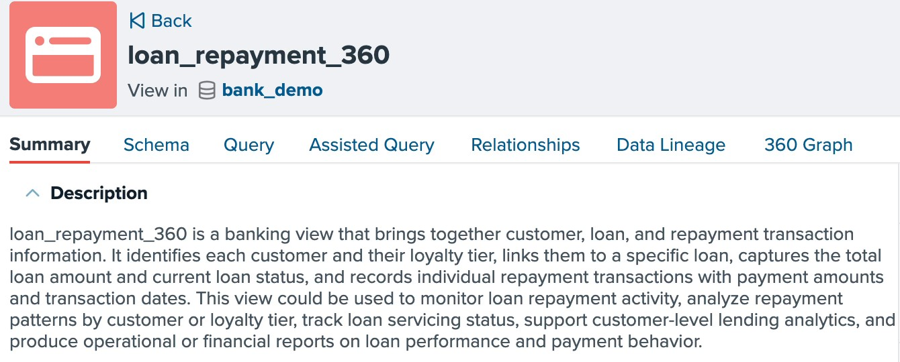

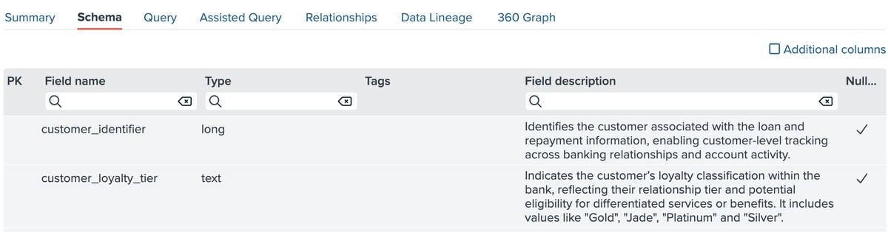

[Watch this step](../../assets/videos/guide/ba-1-clip.mp4): The Summary tab with the product description, then the Schema tab with a business description for each field.

**Why this matters:** You find data by what it means, not by database table names.

**You should see:** loan_repayment_360 is open and you have read its description and field descriptions.

### 2. See where the data comes from

Data Lineage shows which views and data sources each field of a data product comes from, so you can trust it before you use it.

1. Open the **Data Lineage** tab to see the product, the views it is built on and the data source behind them.
2. In the **Fields** list, select a field, such as **customer_loyalty_tier**, to follow it back to its source.

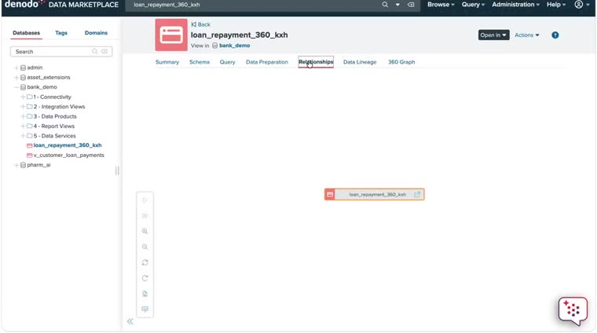

[Watch this step](../../assets/videos/guide/ba-lineage-clip.mp4): Data Lineage: the product, the views it joins and the bank data source.

**Why this matters:** You can see that the product combines customers, loans and loan payments from Crestbank’s bank data source, without asking anyone.

**You should see:** Data Lineage shows loan_repayment_360 built on the customers, loans and loan_payments views and the bank data source.

### 3. Count repayments and add up the amounts

To compare loyalty tiers, you need three things: the tier, the number of repayments and the total amount repaid. You pick those fields and tell Denodo to count and add them up.

1. Open the **Query** tab to build a query without writing SQL.
2. Drag **customer_loyalty_tier**, **payment_transaction_identifier** and **payment_transaction_amount** from **Fields** into **Output columns**, so the result shows one tier per row with its repayments.
3. On payment_transaction_identifier, open the three-dot menu and choose **Apply aggregation function > COUNT**, to count the repayments in each tier.
4. On payment_transaction_amount, choose **SUM** the same way, to add up the amount repaid in each tier.

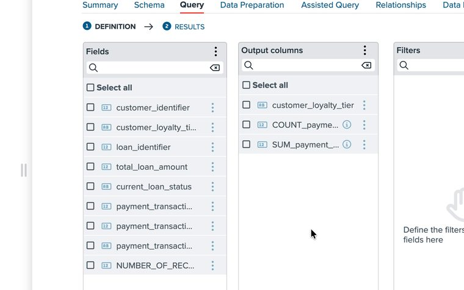

[Watch this step](../../assets/videos/guide/ba-2-clip.mp4): The three fields dragged into Output columns, then COUNT and SUM applied.

**You should see:** Output columns shows customer_loyalty_tier, COUNT_payment_transaction_identifier and SUM_payment_transaction_amount.

### 4. Filter to Gold and Platinum

Crestbank wants to compare repayments from its two highest loyalty tiers. **customer_loyalty_tier** records each customer’s tier in the bank’s loyalty programme, such as Silver, Gold or Platinum. A filter keeps only Gold and Platinum customers, so the counts and totals cover those two tiers.

1. Drag **customer_loyalty_tier** from **Fields** into **Filters**. The **Filter wizard** opens.
2. Set **Operator** to **in** and switch on **Add multiple literals**, so you can enter more than one tier.
3. Type **'Gold'**, select **+**, type **'Platinum'**, then select **Ok**.

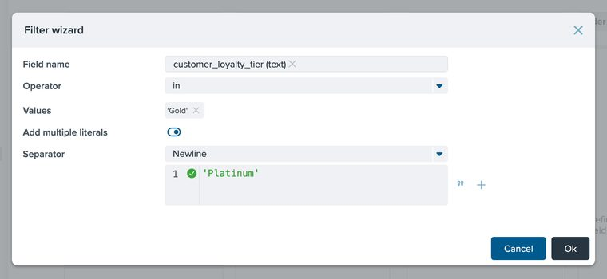

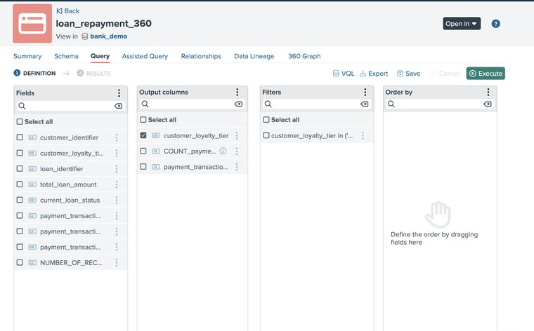

**You should see:** Filters shows customer_loyalty_tier in ('Gold', 'Platinum').

### 5. Sort and run the query

The question is now set up: repayment counts and totals for Gold and Platinum customers. Sorting puts the tier with the most money repaid first, then Execute runs the query against Crestbank’s live sources.

1. Drag **SUM_payment_transaction_amount** from **Output columns** into **Order by**, so the result is ranked by the total amount repaid.
2. Open its three-dot menu and choose **Change to DESC**, so the highest total appears first.
3. Select **Execute** to run the query and see the answer.

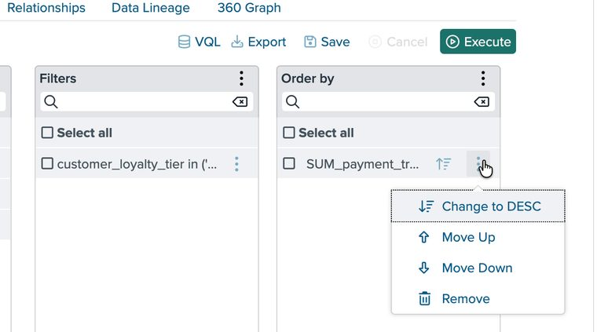

[Watch this step](../../assets/videos/guide/ba-4-clip.mp4): SUM dragged into Order by, Change to DESC, then Execute.

**Why this matters:** No SQL to write: Denodo works out the grouping for you.

**You should see:** 2 rows. Gold: 7 repayments, 17600.0. Platinum: 6 repayments, 13900.0.

### 6. Export the result

The result shows the answer: how many repayments each tier made and how much it repaid in total. Exporting it as a CSV file gives you a copy to open in Excel or share with your team.

1. Check the result under **Results**: one row per loyalty tier, with the repayment count and the total amount.
2. Select **Export** to save the result as a file.
3. Choose **CSV** and **All results**, and keep **Export header** ticked, so the file has every row and the column names.
4. Select **Ok** to download the file.

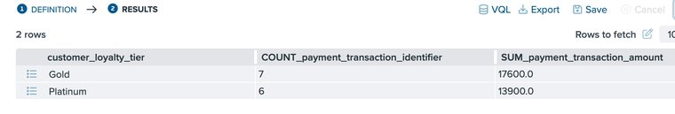

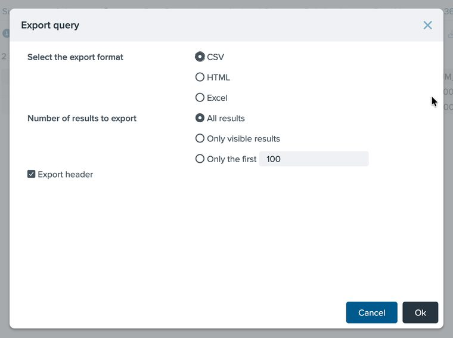

[Watch this step](../../assets/videos/guide/ba-5-clip.mp4): The result, then the Export query dialog and the downloaded CSV file.

**You should see:** A CSV file with the two rows downloads.

### 7. Open Denodo Assistant

Denodo Assistant answers questions in plain English using the data products you can access. Before you ask about loan repayments, check which agent skills it can use: skills are reviewed query patterns that Crestbank has published for its bank data.

1. Select the **Denodo Assistant** icon at the bottom right to open the Assistant beside the data product.
2. Select the database icon, then under **Databases** choose **Select All**, so both **bank_demo** and **asset_extensions** are ticked. The bank data is stored in bank_demo and the agent skills are stored in asset_extensions, so the Assistant needs both.
3. Ask the question below to see which skills the Assistant can use.

```
Which skills do you have available?
```

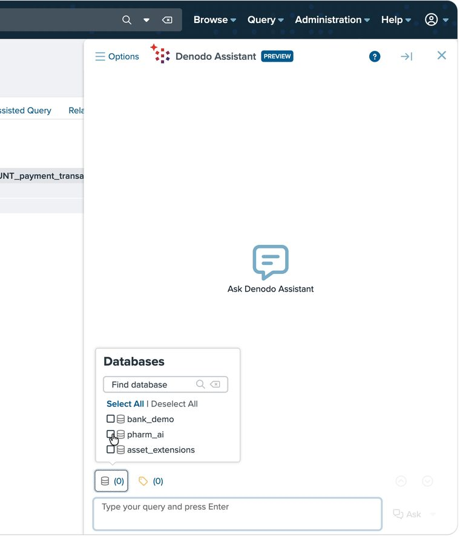

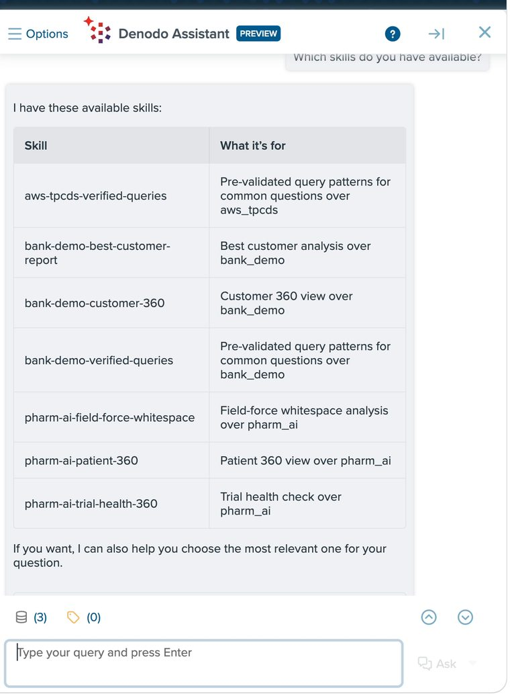

[Watch this step](../../assets/videos/guide/ba-6-clip.mp4): Denodo Assistant opened, both databases selected, then the reply that lists the bank skills.

**Why this matters:** The Assistant follows a skill instead of writing its own joins.

**You should see:** The reply names the bank skills, including bank-demo-verified-queries.

### 8. Ask with a verified agent skill

Now ask a business question and tell the Assistant which agent skill to use. Query 3 in the skill bank-demo-verified-queries ranks customers by how much they have repaid, so the Assistant runs a reviewed query instead of writing its own.

1. Paste the request below into the box at the bottom of Denodo Assistant, so the Assistant knows the skill and the query to use.
2. Check that the database icon still shows **(2)**, so both bank_demo and asset_extensions are selected.
3. Select **Ask** to send the request and get the ranked list.

```
Use the bank-demo-verified-queries skill, query 3: top customers by total recorded repayments. Run it on bank_demo and return the top 10 customer IDs with their number of payments and total recorded payments.
```

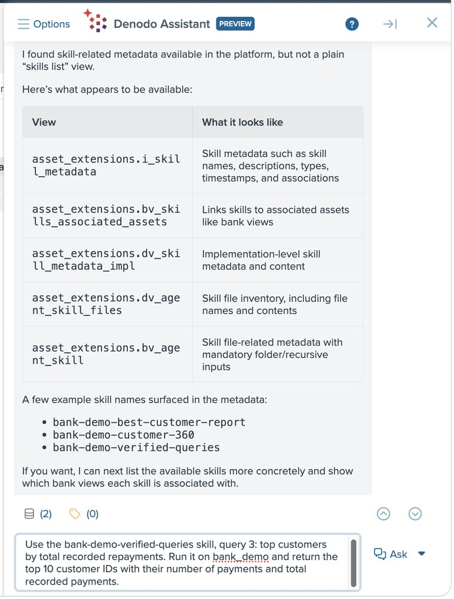

[Watch this step](../../assets/videos/guide/ba-7-clip.mp4): The request sent to Denodo Assistant, its steps, then the ranked list of customers.

**Why this matters:** The same governed data as your own query, asked in plain English and answered with a query pattern Crestbank has reviewed and published.

**You should see:** A ranked list of customers. Customer 23 is first, with 3,700.

## What happens next in the story

You answered Crestbank’s question from a data product someone else built and published. To answer a new question, for example repayments by loan status or with fields the product does not have yet, you would ask a data engineer to extend it. The Data Engineer tour shows how this product is built from live sources in a few minutes.
