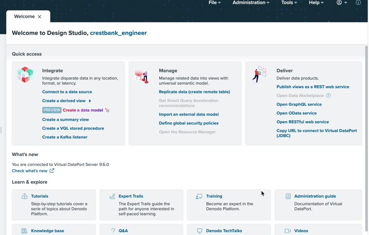
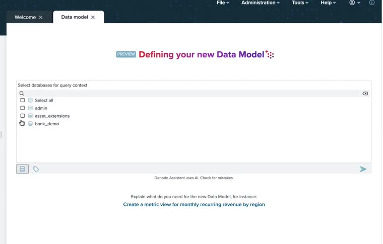
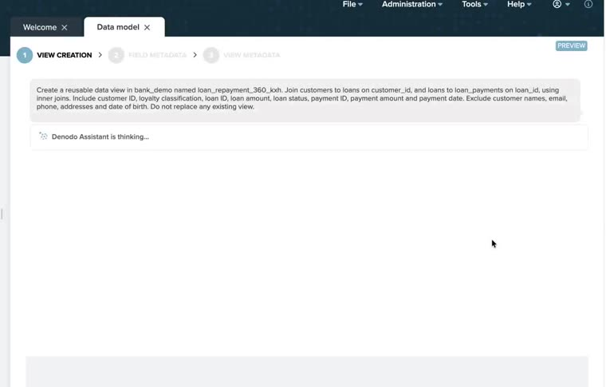
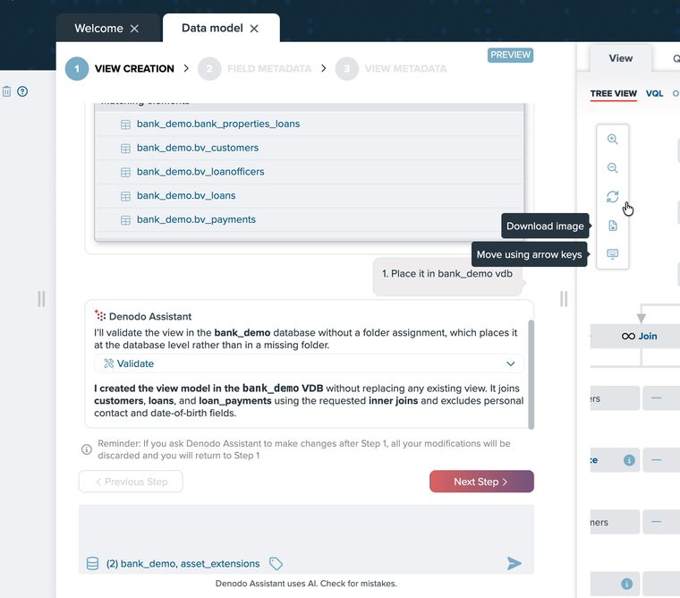
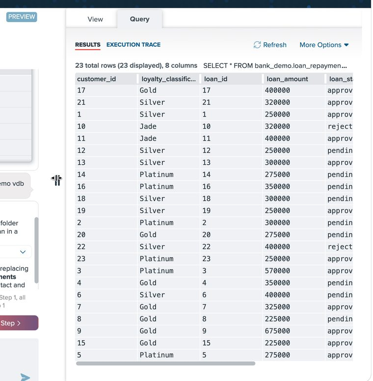
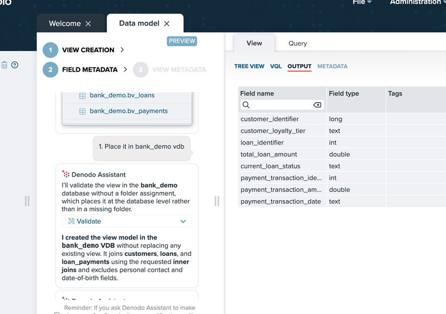
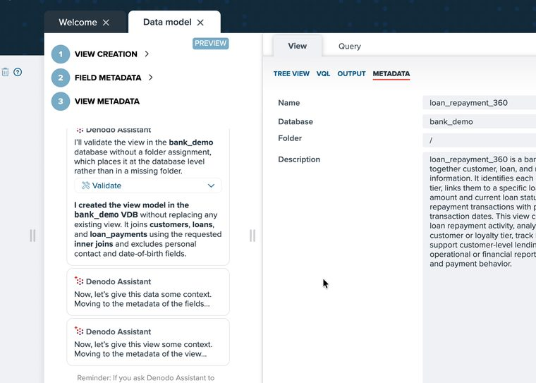
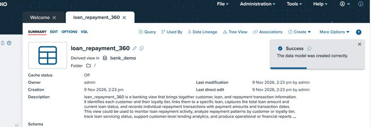
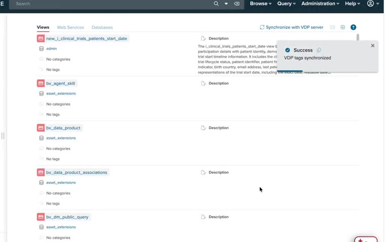
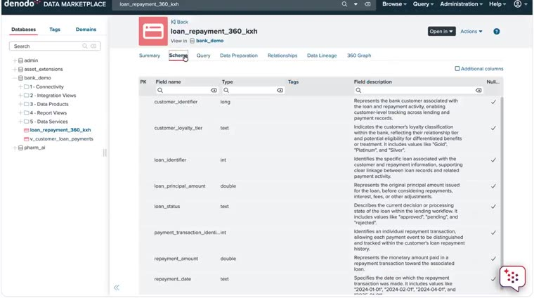

# Data Engineer tour

About 5 min · 8 steps · Live Denodo Platform

Federate live data sources, create a data model, add metadata and publish it as a reusable data product in Denodo, without writing code.

## Why this tour

Crestbank’s analysts need one governed view of customers, their loans and their repayments. Today these are three separate views in the bank_demo database. You build that view with the Data Modeling Wizard and publish it, so analysts and AI agents can use it.

**Sign in as:** `crestbank_engineer`

## Steps

### 1. Sign in to Design Studio

Design Studio is where data engineers connect data sources and build views in Denodo.

1. Select **Open Design Studio**.
2. Sign in as **crestbank_engineer**.



**You should see:** Design Studio shows Welcome to Design Studio, crestbank_engineer.

### 2. Describe the view to the Data Modeling Wizard

The Data Modeling Wizard is Denodo Assistant inside Design Studio. You describe the view you need in plain English, and it finds the source views, writes the joins and validates the result, so you get a working view in minutes instead of writing VQL by hand.

1. In Design Studio, choose **File > New > Data Model**. The **Data model** tab opens with **Defining your new Data Model**.
2. Paste the request below into the box. Do not send it yet: in the next step you choose the databases the wizard can use.

```
Create a reusable data view in bank_demo named loan_repayment_360_<suffix>. Join customers to loans on customer_id, and loans to loan_payments on loan_id, using inner joins. Include customer ID, loyalty classification, loan ID, loan amount, loan status, payment ID, payment amount and payment date. Exclude customer names, email, phone, addresses and date of birth. Do not replace any existing view.
```



[Watch this step](../../assets/videos/guide/de-1-clip.mp4): The request pasted into the Data Modeling Wizard.

**Why this matters:** You describe the result. The wizard reads the views’ metadata, so it finds the join keys itself.

**You should see:** The request is in the box under Defining your new Data Model.

### 3. Choose the databases and send the request

1. Select the database icon at the bottom left of the box. **Select databases for query context** opens.
2. Tick **bank_demo** and **asset_extensions**, so the wizard can read the bank views and the agent skills.
3. Press **Enter** to send the request.



[Watch this step](../../assets/videos/guide/de-2-clip.mp4): The databases selected for the query context.

**Why this matters:** The wizard only reads the databases you choose, so it cannot pick up views from other projects.

**You should see:** Denodo Assistant starts: it runs Metadata search, then Generate and Validate.

### 4. Check the model and preview the rows

1. Wait for the Assistant to report that it created and validated the view.
2. On the right, open **View > TREE VIEW** to see a projection over two joins.
3. Open the **Query** tab to preview the rows the view returns.
4. Select **Next Step**.





[Watch this step](../../assets/videos/guide/de-3-clip.mp4): The Assistant builds and validates the view, then the tree view and the rows.

**Why this matters:** The join is defined once, in Denodo. Every analyst, report and agent gets the same rows.

**You should see:** Query shows 23 total rows and 8 columns.

### 5. Review the field metadata

1. The wizard suggests field names, then field descriptions.
2. Check them on the **OUTPUT** tab and edit any you want to change.
3. Select **Next Step**.



[Watch this step](../../assets/videos/guide/de-4-clip.mp4): The wizard suggests field names and descriptions on the OUTPUT tab.

**Why this matters:** These descriptions are what analysts read in the Data Marketplace and what AI agents read through MCP.

**You should see:** Each of the eight fields has a business-friendly name and a description.

### 6. Review the view metadata and create the view

1. Check **Name** (loan_repayment_360_<suffix>), **Database** (bank_demo) and the suggested **Description**.
2. Select **Create view**.





[Watch this step](../../assets/videos/guide/de-5-clip.mp4): VIEW METADATA, Create view, then the new view opens.

**You should see:** The message Success: The data model was created correctly.

### 7. Sync the Data Marketplace with Virtual DataPort

The Data Marketplace keeps its own copy of the Virtual DataPort catalog. A new view appears there after a sync.

1. Select **Open Data Marketplace**. If asked, sign in as **crestbank_engineer**.
2. Open **Administration > Sync with VDP**.
3. The sync has four screens. On **Database changes**, select **Continue**.
4. On **View changes**, check that **loan_repayment_360_<suffix>** is listed under **New views in server**, then select **Continue**.
5. On **Web service changes**, select **Continue**. On **Select the VDP tags to synchronize**, keep the selected tags and select **Continue**.



[Watch this step](../../assets/videos/guide/de-6-clip.mp4): The four sync screens, then the Success messages.

> The user who runs the sync needs the METADATA privilege on every element of the catalog. If Sync with VDP is not in your Administration menu, your trial administrator can run it.

[Denodo documentation: Synchronize with Virtual DataPort](https://community.denodo.com/docs/html/browse/latest/en/vdp/data_catalog/administration/synchronize/synchronize)

**Why this matters:** Design Studio and the Data Marketplace are separate applications. The sync is what makes your view discoverable.

**You should see:** Success messages for views, web services and VDP tags.

### 8. Find your view in the Data Marketplace

1. Open **Browse > Databases / Folders**, then **bank_demo > 3 - Data Products**.
2. Select **loan_repayment_360_<suffix>**, then check its **Summary** and **Schema**.



[Watch this step](../../assets/videos/guide/de-7-clip.mp4): Browse to bank_demo, open your view, then its Summary and Schema.

**You should see:** loan_repayment_360_<suffix> opens with its description and eight described fields.

## What happens next in the story

You built and published the data product the Business Analyst queries: one governed view over live customer, loan and repayment data, with descriptions that analysts and AI agents can read. Next, the AI Builder puts this product behind an agent, so anyone at Crestbank can ask about repayments in plain English.
